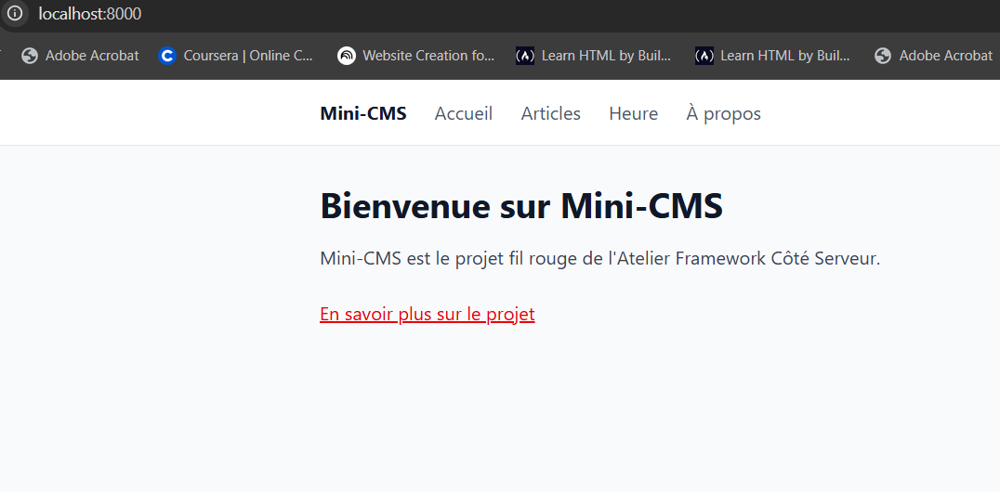
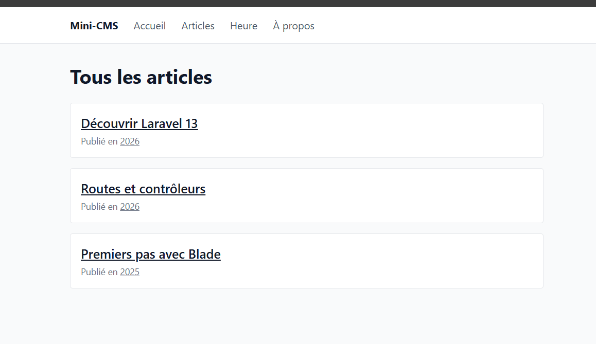
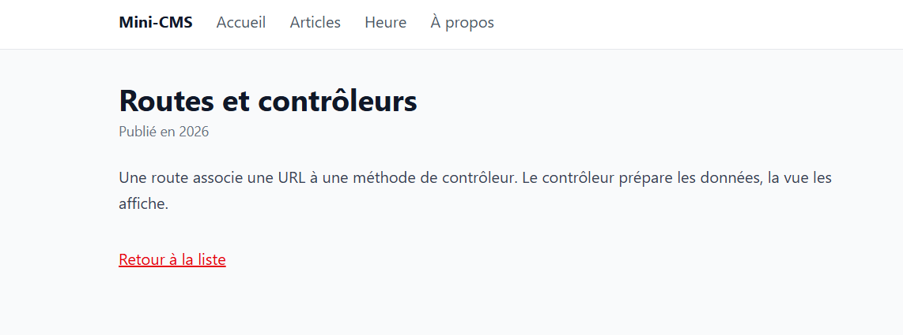
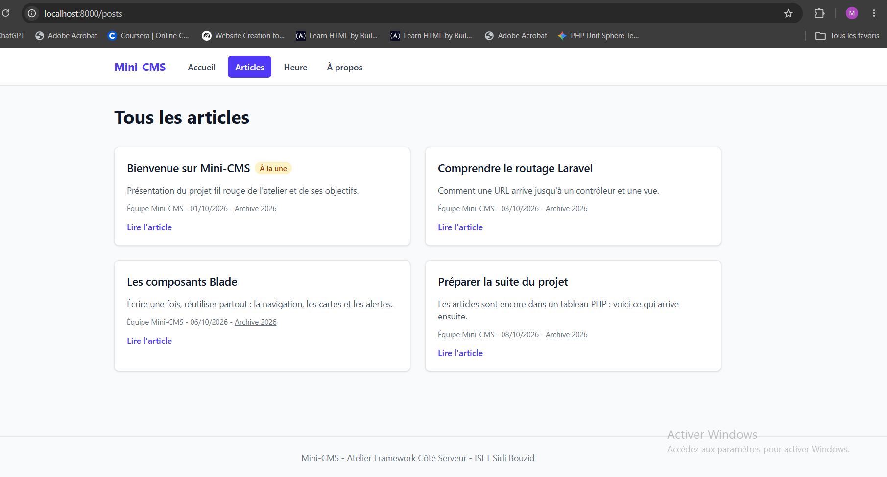

# Mini-CMS

Projet fil rouge de l'Atelier Framework Cote Serveur (Laravel 13, PHP 8.3+).

Auteur : Meriem, groupe 1.

Mini-CMS evoluera au fil du semestre vers une petite plateforme de publication.

## État actuel (tag lab-02b)

- Pages construites avec des composants Blade anonymes : `x-navbar`, `x-nav-link`, `x-post-card`, `x-alert`, `x-page-header`.
- Lien actif dans la navigation avec `request()->routeIs()`.
- Articles toujours stockés dans un tableau PHP, sans base de données pour l'instant.

## Routes disponibles

| Méthode | URI | Nom | Action |
|---|---|---|---|
| GET | `/` | `home` | `PageController@home` |
| GET | `/a-propos` | `about` | `PageController@about` |
| GET | `/heure` | `time` | `PageController@time` |
| GET | `/posts` | `posts.index` | `PostController@index` |
| GET | `/posts/archive/{year}` | `posts.archive` | `PostController@archive` |
| GET | `/posts/{slug}` | `posts.show` | `PostController@show` |

## Prerequis

- PHP 8.3 ou plus recent avec Composer.
- Node.js LTS et npm.
- Git.

## Installation

### Bash

```bash
composer install
cp .env.example .env
php artisan key:generate
php artisan migrate
npm install
npm run build
php artisan serve
```

### PowerShell

```powershell
composer install
Copy-Item .env.example .env
php artisan key:generate
php artisan migrate
npm install
npm run build
php artisan serve
```

Application disponible sur http://localhost:8000.

## Captures

- `screenshots/s01-accueil.png`
- `screenshots/s01-route-list.png`
- `screenshots/s02-a-propos.png`

### Accueil avec le layout



### Liste des articles



### Détail d'un article



### Session 04


